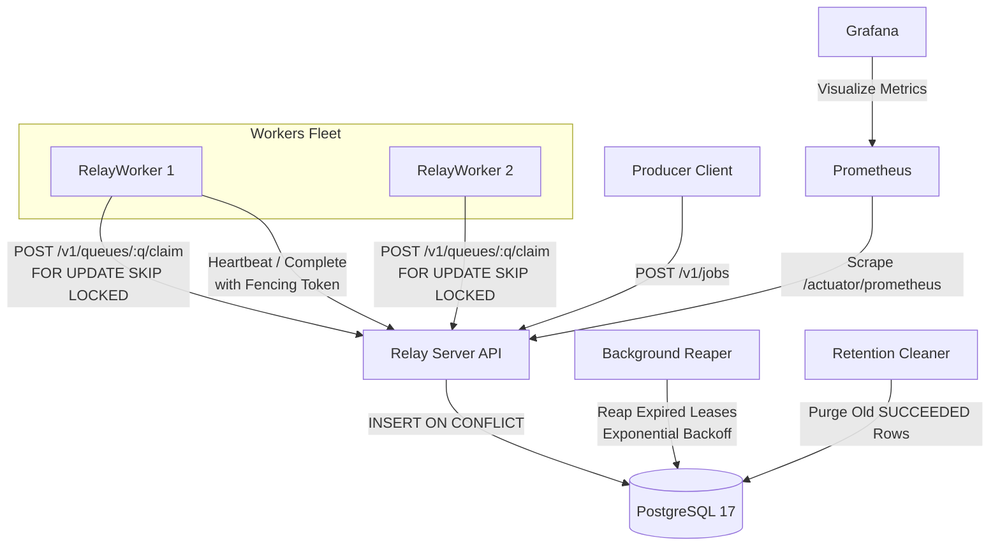

# Relay

A fault-tolerant distributed job scheduler. Applications submit units of work (jobs);
a fleet of workers claims and runs them reliably — even when workers crash, the
network drops, or the database slows down.

The focus is not feature count. It is reliability and evidence: a written contract
of guarantees, automated failure injection that tries to break them, and published
measured results.

## Architecture



## Guarantees

1. An accepted job is never lost, even if workers or scheduler nodes crash.
2. Delivery is at-least-once: a job may run more than once, never zero times (unless moved to DEAD).
3. Submitting the same idempotency key twice creates only one job.
4. At most one worker holds a valid lease on a job at any moment (enforced via `SKIP LOCKED`).
5. A worker whose lease expired cannot complete, fail, or extend that job (fencing tokens).
6. A job failing `max_attempts` times moves to DEAD instead of retrying forever.
7. Retries use exponential backoff with full jitter to prevent retry storms.

See `docs/design.md` for the full contract, state machine, and mechanisms.

## Quickstart

Prerequisites: Java 21, Maven 3.9+, Docker.

```bash
docker compose up
```

This starts PostgreSQL, the Relay API (http://localhost:8080), Prometheus (http://localhost:9090), and Grafana (http://localhost:3000, admin/admin).

Run the full test suite (24 tests across all modules):

```bash
mvn test
```

## Modules Layout

```
relay/
  relay-server/       Spring Boot REST API, lease management, reaper loop, Flyway migrations
  relay-worker-sdk/   Java client library and polling loop used by worker processes
  relay-chaos/        Failure injection tests (C1-C10) and invariant checker (I1-I8)
  relay-bench/        Load generator and benchmark suite (B1, B2, B5)
  docs/
    design.md         State machine contract, SQL operations, and lease mechanisms
    benchmarks/       Measured throughput, latency, and recovery results
    bugs.md           Log of correctness bugs discovered by tests and their fixes
  observability/      Prometheus scrape configuration
```

## Measured Benchmarks

Benchmarked against local PostgreSQL 17 via `relay-bench` (`BenchmarkRunner`):

| Experiment | Metric | Measured Value | Notes |
|---|---|---|---|
| **B1: Worker Scaling** | Throughput | 128 j/s (1 worker) → 549 j/s (16 workers) | Non-blocking `SKIP LOCKED` |
| **B1: Latency** | p50 / p95 | 29 ms / 44 ms (4 workers) | Single HTTP round-trip |
| **B2: Batching** | Batch Claim | 322 j/s (batch=1) → 641 j/s (batch=50) | Reduces DB query count |
| **B5: Lease Failover** | Recovery Time | 2.48 seconds | Reaper scan + retry jitter |

Detailed setup and charts: `docs/benchmarks/results.md`.

## Defensible Resume Bullets

- *Engineered a fault-tolerant distributed job scheduler in Java 21, Spring Boot, and PostgreSQL 17, providing at-least-once delivery and non-blocking concurrent claiming via `FOR UPDATE SKIP LOCKED`.*
- *Implemented monotonic fencing tokens, heartbeat lease renewal, and background reapers with exponential backoff and jitter, strictly preventing split claims and stale worker overwrites (HTTP 409).*
- *Developed an automated failure-injection harness and invariant checker (`relay-chaos`), proving 8 consistency invariants (I1–I8) hold during worker crash mid-job, SIGSTOP pauses, and concurrent idempotency storms.*
- *Benchmarked worker scalability up to 640+ jobs/s, instrumented real-time queue depth and lease metrics with Micrometer, Prometheus, and Grafana, and automated CI pipelines with Docker and Testcontainers.*

